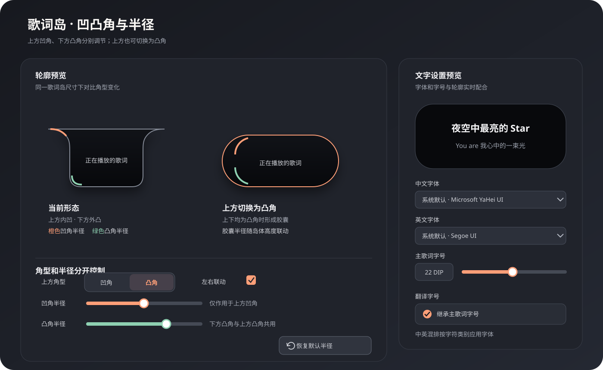

# 歌词岛字体、字号与形状自定义方案

- 状态：设计提案，待评审
- 日期：2026-10-18
- 范围：桌面歌词岛的歌词文字与岛体轮廓
- 依据：V3 路线图中的“更多歌词岛形状与自定义轮廓”“各模块独立字体”；沿用现有 WPF 设置页和设置生命周期

## 目标

让用户能调整歌词岛的字体、字号和外轮廓，同时保留清晰可读、可恢复默认、可预览的设置体验。默认值应与现有外观一致；只改展示，不改变歌词内容、同步、播放器或任务栏歌词坞。



图中按现有歌词岛轮廓表达：上方两角向内凹，下方两角向外凸。用户可分别调整凹角与凸角半径，并把上方凹角切换为凸角；上下角都为凸角并使用胶囊半径时，岛体成为胶囊形。

## 设置入口与信息结构

在现有“设置 → 歌词外观 → 歌词岛”卡片中增加“文字”和“形状”两个折叠分区。继续沿用当前卡片、间距、控件和语义圆角资源，不重做设置窗口。

### 文字

| 控件 | 建议行为 |
| --- | --- |
| 中文字体 | 独立下拉选择本机已安装字体，控制中文字符和中文标点；提供“系统默认”和当前生效字体预览。 |
| 英文字体 | 独立下拉选择本机已安装字体，控制拉丁字母、英文单词和数字；不随中文字体选择改变。 |
| 字号 | 数值框加滑块，单位为 WPF DIP；建议范围 10–48 DIP，默认值沿用当前歌词模块字号。支持键盘输入、步进调整和恢复默认。 |
| 翻译字号 | 可选的“单独设置翻译字号”；关闭时继承主歌词字号，开启后显示同样的数值控件。 |
| 即时预览 | 在设置页预览区显示中文、英文及中英混排歌词和一行翻译，分别使用对应字族及实际字号、字重、颜色；长文本自动换行或滚动，不缩小命中区。 |

中文字体与英文字体只作用于歌词文字模块，不改歌曲信息、播放控制、按钮或任务栏歌词坞。翻译默认继承同一组中英字体；字号可按上表独立设置。未来若要支持模块各自的字体，沿用同一字段定义扩展到相应模块，不在本提案中增加更多模块设置。

### 中英混排规则

- 一句歌词可按字符类别拆成多个连续文本片段渲染：汉字和中文标点使用中文字体，拉丁字母、英文标点和阿拉伯数字使用英文字体。字体切换只影响字形绘制，不改原歌词字符串、字符索引和时间戳。
- 日文假名、韩文、特殊符号及表情符号不归入中/英选择范围，优先使用系统回退字体；字体缺少所需字形时也按操作系统字体回退机制显示，避免方框字。
- 逐字跟随高亮、滚动、对齐和文字宽度测量需基于最终混排后的实际字形布局，不能因分段而改变歌词时间线或高亮的字符位置。

### 形状

形状设置围绕现有的凹凸轮廓展开，不把“顶部曲线”误做成额外凸包。

| 项目 | 建议选项与规则 |
| --- | --- |
| 上方两角 | 默认“凹角”，提供凹/凸切换与半径控制。左右默认联动；高级选项可解除联动，分别调整左上、右上。 |
| 下方两角 | 保持凸角，提供凸圆角半径控制。左右默认联动；高级选项可分别调整左下、右下。 |
| 凹角半径 | 控制上方边缘向岛体内部收进的曲线弧度；不与凸角半径共用一个值。 |
| 凸角半径 | 控制向外圆弧的弯曲程度。上方切换为凸角后也使用凸角半径；达到当前岛体高度的一半时形成胶囊端帽。 |
| 恢复默认半径 | 半径区提供“恢复默认半径”按钮，一键恢复凹角、凸角及四角覆盖值为产品默认值；默认值须复现当前歌词岛轮廓。只重置半径，不改变上方凹/凸模式。 |
| 胶囊快捷方式 | 一键将上方两角切换为凸角，并按当前岛体高度应用胶囊半径；高度变化时重算，不保存过期的绝对尺寸。 |
| 即时预览 | 同步显示当前播放中的真实岛体预览；无播放时使用静态样例。提供单行、多行预览切换，观察轮廓和内容留白。 |

## 形状模型

形状模型需要表达每处圆角的凹凸方向和半径。默认轮廓为上方凹角、下方凸角；切换上方角为凸角时，几何方向随之翻转，并采用凸角半径。左右半径默认成对联动，解除联动后四处可分别编辑。

建议的内部展示设置字段（字段名为概念名，最终以实现审查为准）：

```text
ChineseLyricFontFamily: nullable string
EnglishLyricFontFamily: nullable string
LyricFontSizeDip: number
TranslationFontSizeDip: nullable number // null 表示继承主歌词字号
TopCornerMode: Concave | Convex
ConcaveCornerRadiusDip: number
ConvexCornerRadiusDip: number
IslandCornerRadiiDip: optional per-corner overrides
```

所有几何值在最终布局尺寸上统一约束，避免自交、负尺寸和圆角互相覆盖。胶囊形由当前高度推导半径；自定义半径使用 DIP，不应因屏幕 DPI 改变而产生额外视觉跳变。轮廓、裁剪、阴影和命中区域共用同一条连续 PathGeometry，并保留现有拖动、悬停和鼠标避让行为。

当前实现已用 PathGeometry 绘制上方内收、下方外圆的轮廓。扩展时应在这条形状几何上加入凹/凸方向和半径参数；单一 `CornerRadius` 无法表达凹角，也无法表达每角独立的方向和半径。

## 交互与设置生命周期

- 控件改动后立即更新设置页预览；当前歌词岛继续使用设置页现有的 220 ms 防抖即时提交体验。
- 点击“恢复默认半径”后，半径控件和预览立即回到产品默认半径；若上方当前为凸角，保留凸角模式，只恢复其半径值。
- 所有编辑值先留在独立的 UI 草稿中；经设置运行时协调器同步后，以返回的有效设置更新 UI 和持久化值。关闭窗口前按现有规则提交待处理的有效修改。
- 应用重启后显示最近一次已提交值；“恢复默认”重置本分区设置并即时提交。
- 新增持久化项必须为旧设置文件定义缺失值默认行为。旧文件缺失新字段时，使用与当前产品一致的默认字体、字号和岛形，不触碰其他偏好。
- 字体在当前系统不可用时，运行时回退系统默认字体；保存原选择以便字体重新可用时恢复，并在设置页明确显示回退状态。

## 分阶段建议

1. **第一阶段：字体与字号** — 中文/英文字体独立选择、主歌词字号、翻译字号继承/独立、中英混排预览和持久化。
2. **第二阶段：凹凸半径控制** — 独立调节上方凹角半径与下方凸角半径，左右默认联动。
3. **第三阶段：上方凸角与单角微调** — 上方凹/凸切换、胶囊快捷方式，以及可选的四角独立半径。验证岛体动画、DWM 圆角、命中测试与鼠标避让。

分阶段可降低字体排版与自定义几何同时上线的风险；用户可先获得常用字体和字号设置，复杂轮廓在 Path 行为验证后交付。

## 验收标准

- 默认安装、旧设置文件、缺失字体、字体被卸载四种情形下均能稳定显示并给出合适回退。
- 中文字体与英文字体可以独立选择；中英混排、数字、中英文标点及双行歌词使用对应字族并保持正确测量、居中、留白和逐字跟随高亮。
- 10–48 DIP 输入边界、键盘输入、滑块步进、恢复默认和重启保持一致。
- 默认上凹下凸、凹角与凸角分别调半径、上方切换为凸角、胶囊形和四角独立半径均无裂缝、自交、裁字或透明背景直角残留。
- “恢复默认半径”能一次恢复凹角、凸角及单角覆盖值，同时保留当前上方凹/凸模式；提交后重启仍保持恢复后的半径。
- 设置预览、实际歌词岛背景、裁切、阴影和命中区域采用一致轮廓；拖动、悬停、点击、鼠标避让与全屏自动隐藏仍按现有规则工作。
- 覆盖 100%、150%、200% DPI，单屏/多屏、常见岛体高度、单行/多行、翻译显示和超长歌词。
- 防抖提交、窗口关闭时刷新待处理修改、重启恢复与运行时有效值有针对性回归；Release 构建和桌面 UI 手动验收分别记录。

## 风险与待评审点

- 字体度量差异会改变歌词宽度和自动折叠临界点；需要确认字号变化是否允许影响自动布局切换的时机。
- 字体枚举量可能较大；建议两个字体选择器均支持键盘首字母/搜索，并在打开下拉框时加载，避免阻塞设置窗口。
- WPF 对混排文本分段后可能影响字体测量、逐字高亮区间和滚动动画；需要使用混排文本的完整布局结果验证，不改变底层歌词字符索引。
- 凹角变凸角后，外轮廓、DWM 裁切和 Win32 命中测试必须同步改变；上方采用胶囊半径时需要验证不同岛体高度与宽度。
- 是否让翻译字号默认独立，建议默认继承以保持现状；独立选项作为显式高级设置。
- 第一版可先采用凹角/凸角成对半径与上方凹凸切换；四角逐一解锁作为高级项，避免初始界面过密。

## 实现边界

- 所属：桌面端岛屿、设置与交互（`LyricHover.App/`）。
- 不涉及 `LyricHover.Core/` 的歌词、时间线或播放器语义；不改变 LyricDock 的窗口与样式。
- 复用现有 `PlacementSettingsWindow`、设置运行时协调器、设置资源与模块渲染入口。
- 本文是方案，不构成对实现、版本递增、发布或路线图顺序的确认。
